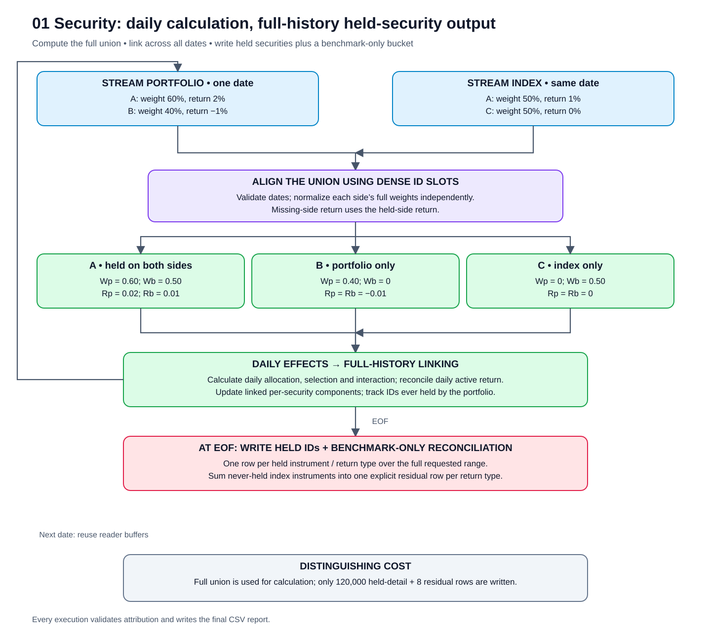
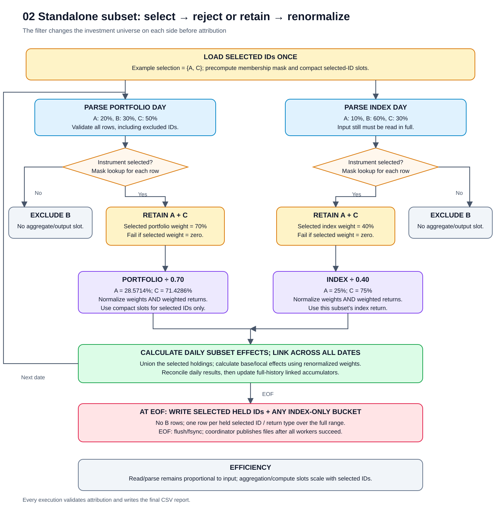
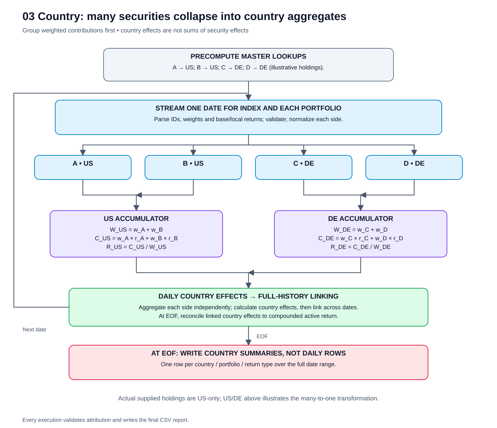
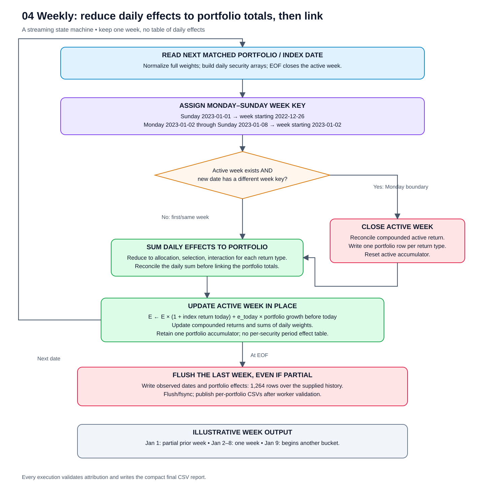
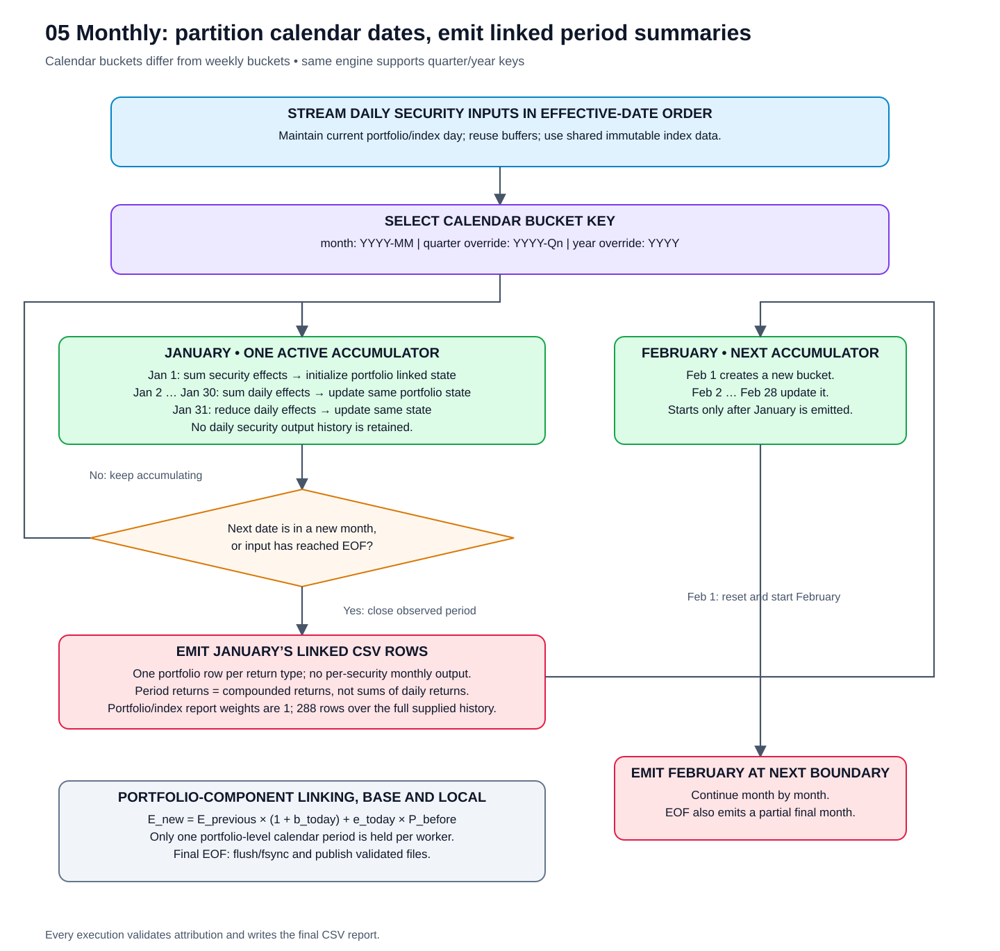

# Attribution flows and stage comparison: Rust and Go

This report contains five scenario comparisons, each with its flowchart, conditions and one Rust/Go metrics table. Subset and country use the completed full-history runs across all 1,095 dates. Security, weekly and monthly retain the three-date benchmark because their full-history attempts exceeded the output-size guard. Repeated measurements are combined into medians and ranges in one table per scenario.

Each scenario below combines its SVG flowchart, efficiency explanation and measured stage metrics. Shared linking and Rust/Go execution details follow the five scenario comparisons.

For full-history size estimates and actual runs stopped at a 5 GB combined-output guard, see [output-size estimates and guarded run outcomes](ATTRIBUTION_OUTPUT_SIZE_REPORT.md). Guard-stopped outputs are incomplete and do not establish full-history performance winners.

## Coverage and method

| Comparison | Scenarios | Effective dates | Repetitions |
|---|---|---|---:|
| Date-limited benchmark | Security, weekly, monthly | 2023-01-01 through 2023-01-03 | 3 per language/scenario |
| Completed full-history runs | Standalone subset, country | 2023-01-01 through 2025-12-30 (1,095 dates) | 3 per language/scenario |

All runs include all four portfolios and their index. Rust uses four native portfolio workers; Go uses GOMAXPROCS=12 and concurrent I/O goroutines. Each implementation uses its own optimized parser, buffering, formatting and runtime approach. Runs alternate language order and use the OS-managed filesystem cache; they are not controlled cold-cache measurements. Security, weekly and monthly values are three-run medians, with overall wall-time ranges. Subset and country combine the two original full-history runs with the subsequent completed size-guarded run per language, reporting three-run medians and min–max wall times. The third run includes size-monitoring overhead, so these are descriptive pooled results across slightly different monitoring conditions, not three identically instrumented trials. Rates divide work by the corresponding median stage duration. Individual source runs remain available for inspection.

**Stage seconds are accumulated elapsed time inside each stage across threads. They can overlap, include scheduling pauses, and must not be added together or interpreted as stage CPU time.** Overall wall time is measured externally for the complete process. Peak memory is the per-process maximum resident set; CPU time includes all process threads; average cores is CPU time divided by process wall time.

Read includes CSV decoding, numeric parsing, security lookup and validation. Its byte rate uses consumed return-file bytes, not the full dataset size for truncated runs. Filter timings include the selection/weight-denominator scan: only the subset scenario applies an instrument predicate; all other scenarios retain all rows. Aggregation includes independent weight normalization, dense-group construction and weighted contributions. Group counts include the index and portfolio input groups on every date, rather than just distinct labels. Compute includes attribution, linking and reconciliation. Write includes numeric formatting, CSV escaping, buffering, flush and fsync. Master loading, setup and channel waits remain in overall time.

**Output effects** below count the three attribution components (allocation, selection, interaction) on every written row, including portfolio-total rows. The derived `Total` field is not counted as a fourth component. Output effects/sec divides this count by compute-stage seconds; it excludes CSV formatting, which belongs to the write stage. Daily detail effect counts are shown separately because linking reduces the number of period output rows.

The first-three-date weekly sample contains two partial weeks; the monthly sample contains one partial month. These are linked results for observed dates, not completed calendar periods. Full-history daily security output would contain approximately 876 million detail rows, about 183–185 GB (170–173 GiB) per language at the observed CSV width, exceeding the available space for both languages. Full-history write performance for security/weekly/monthly has therefore **not** been measured.

## Industry relevance and modelling limits

| View | Practical role | Interpretation of this benchmark |
|---|---|---|
| Security detail | Explain individual-company contributions and investigate winners/losers | Useful calculation/drilldown grain; exporting every benchmark constituent every day is an output-design choice, not an industry requirement |
| Weekly linked view | Assessment: useful for tactical/internal monitoring when a team needs weekly review | A calendar reporting frequency of the daily engine, not another attribution model |
| Monthly linked view | Established performance reporting/analysis interval; longer periods require consistent compounding/linking | Same engine as weekly, with a different bucket key and fewer emitted rows |

FactSet describes benchmark-relative analysis at company or group level in its [performance attribution explanation](https://insight.factset.com/keeping-up-with-compliant-benchmarks-for-performance-attribution). MathWorks documents [monthly and compounded multi-period Brinson analysis](https://www.mathworks.com/help/finance/performance-attribution-using-brinson-model.html), using category/sector weights and returns. These support the usefulness of granular drilldown and period reporting; the weekly monitoring use above is an assessment, not a claim of a mandatory industry standard.

Brinson allocation/selection is commonly interpreted over decision groups such as sectors or countries. Treating every InstrumentId as its own Brinson group is a modelling choice. For an identical security on the same return basis, if its portfolio and index returns are equal, the per-security selection term is zero by this implementation’s formula. The [synthetic generator](python/generate_attribution_csvs.py) samples returns independently by entity, so the same ID can have different portfolio/index returns. Its nonzero security selection effects demonstrate software calculations, not validated economic security-selection insight.

For production use, my recommendation is security-level calculation with requested drilldowns, plus linked period summaries by portfolio and meaningful decision groups. The current benchmark deliberately emits detailed CSVs, so its write volume should not be mistaken for a necessary industry delivery format. The all-US country fixture also tests reading/reduction performance more than realistic cross-country allocation.

## Scenario flow overview

These diagrams describe the implemented Rust and Go logic, rather than a proposed redesign. Each SVG is standalone and can be opened in a browser, enlarged, or embedded in a document.

## Five scenarios at a glance

| Scenario | Efficient read/filter | Efficient compute | Efficient write |
|---|---|---|---|
| Full security | Stream one date at a time; reuse CSV/day buffers; read index once per active portfolio batch | Dense instrument slots; union of portfolio/index holdings; independent base/local effects | Stream daily security details and total rows to each portfolio’s buffered CSV |
| Standalone subset | Parse and validate all rows; apply a precomputed selection mask on both sides | Independently normalize selected weights; use compact selected-ID slots so aggregation/effect loops avoid the full master | Write selected-universe details and totals; excluded instruments produce no output |
| Country | Resolve instrument-to-country mapping once; stream current-day holdings | Aggregate weight and weighted contributions by country before calculating effects | Write country details and totals rather than security rows |
| Weekly | Stream daily holdings; assign dates to Monday–Sunday buckets | Calculate daily security effects, then update one linked weekly accumulator | Write once per observed week at the next bucket boundary or EOF; include partial weeks |
| Monthly | Stream daily holdings; assign dates to calendar-month buckets | Calculate daily security effects, then update one linked monthly accumulator | Write once per observed month at the next bucket boundary or EOF; quarter/year use the same path |

The diagrams use different structures to expose the actual transformation in each scenario: security union, filter/reject branches, a many-to-one country funnel, a weekly state machine, and a calendar-month progression. Holdings and dates shown inside nodes are illustrative; the country diagram explicitly distinguishes its US/DE example from the US-only supplied data. January and February are successive active periods, not parallel accumulators.

The shared execution engine remains the same: one index producer broadcasts immutable daily arrays to portfolio workers through bounded channels. Each portfolio worker reads its own input and owns its accumulator and CSV writer. The diagrams focus on scenario logic; the Rust/Go execution table below documents the shared concurrency layer.

## Five-scenario comparison

### 1. Full security-level attribution

[Open standalone SVG](docs/flows/01-security.svg)



Dense numeric instrument slots remove string-key joins from the effect loop. Presence flags preserve instruments held on only one side. The daily effects reconcile to portfolio minus index return. Full daily output still has a large inherent write cost: approximately 876 million detail rows for the supplied full history.

**Scope:** first three dates (2023-01-01 through 2023-01-03), all four portfolios; median of three runs per language. Full-history attempts were guard-stopped and are not included as completed performance results.

#### Stage metrics

| Stage | Metric | Rust | Go |
|---|---|---:|---:|
| Read and parse CSV | Seconds | 0.071842 | 0.107602 |
|  | Million rows/sec | 6.681 | 4.461 |
|  | Input MiB/sec | 402.968 | 269.047 |
|  | Rows read | 480,000 | 480,000 |
| Filter | Seconds | 0.000256 | 0.000855 |
|  | Rows examined | 480,000 | 480,000 |
|  | Rows retained | 480,000 | 480,000 |
|  | Rows excluded | 0 | 0 |
| Aggregate | Seconds | 0.004563 | 0.005709 |
|  | Records processed/sec | 105,183,439.92 | 84,078,405.21 |
|  | Records processed | 480,000 | 480,000 |
|  | Groups produced (input entity/group/date combinations) | 480,000 | 480,000 |
| Compute attribution and linking | Seconds | 0.013469 | 0.041607 |
|  | Output effects/sec (3 components × CSV rows) | 534,548,091.62 | 173,047,463.70 |
|  | Output effect components (includes total rows) | 7,200,072 | 7,200,072 |
|  | Daily detail effect components computed | 7,200,000 | 7,200,000 |
| Write CSV | Seconds | 0.751416 | 0.904783 |
|  | Rows/sec | 3,194,000.31 | 2,652,597.60 |
|  | Output MiB/sec | 644.082 | 527.568 |
|  | Rows written (detail + total) | 2,400,024 | 2,400,024 |
|  | Output MiB | 483.974 | 477.335 |
| Overall | Wall time (seconds) | 0.282638 | 0.325493 |
|  | Wall time min–max (seconds) | 0.274462–0.293105 | 0.323800–0.328624 |
|  | Peak memory (MiB) | 117.172 | 207.828 |
|  | CPU time (seconds) | 0.847354 | 1.056990 |
|  | Average cores used | 2.998 | 3.240 |

### 2. Standalone instrument subset

[Open standalone SVG](docs/flows/02-subset.svg)



Selected IDs are mapped once to a mask and compact output slots. The filter is applied after CSV parsing and validation: it reduces aggregation, computation and output work, but does not avoid reading the source CSVs. Each side’s selected weights are normalized independently on every date. A zero selected-weight denominator fails explicitly. The selected index supplies the benchmark return; full-index weights and returns are not used for this scenario’s attribution.

**Scope:** all 1,095 dates, all four portfolios; median of three completed runs per language (two original runs plus one run under the combined 5 GB output guard).

#### Conditions

Predicate: `InstrumentId IN selected_ids`, where `selected_ids` is the union of these four inclusive ranges:

- `S000001`–`S000100`
- `S015001`–`S015100`
- `S030001`–`S030100`
- `S045001`–`S045100`

This is exactly 400 IDs, listed in [subset.csv](results/native-full-history/subset.csv): the first 100 IDs from each portfolio. Apply the same predicate to both portfolio and index. Each portfolio retains 100 holdings/day; the index retains 400 holdings/day. Normalize each selected side independently to 100% every date, and compare against the selected index. This is a standalone-subset return, not those instruments’ contribution to the original full portfolio.

Across all files: 175,200,000 input rows examined, 876,000 retained, 174,324,000 excluded. Both languages wrote 3,512,760 attribution rows; every numeric field matched (maximum difference 0). Attribution CSV size: Rust 759,396,377 bytes; Go 740,854,715 bytes; combined 1,500,251,092 bytes (1.500 GB), excluding the small metrics CSVs.

#### Stage metrics

| Stage | Metric | Rust | Go |
|---|---|---:|---:|
| Read and parse CSV | Seconds | 23.461249 | 35.373401 |
|  | Million rows/sec | 7.468 | 4.953 |
|  | Input MiB/sec | 450.447 | 298.757 |
|  | Rows read | 175,200,000 | 175,200,000 |
| Filter | Seconds | 0.072126 | 0.164994 |
|  | Rows examined | 175,200,000 | 175,200,000 |
|  | Rows retained | 876,000 | 876,000 |
|  | Rows excluded | 174,324,000 | 174,324,000 |
| Aggregate | Seconds | 0.007064 | 0.009949 |
|  | Records processed/sec | 124,015,555.74 | 88,048,235.96 |
|  | Records processed | 876,000 | 876,000 |
|  | Groups produced (input entity/group/date combinations) | 876,000 | 876,000 |
| Compute attribution and linking | Seconds | 0.012133 | 0.033013 |
|  | Output effects/sec (3 components × CSV rows) | 868,581,677.11 | 319,220,011.56 |
|  | Output effect components (includes total rows) | 10,538,280 | 10,538,280 |
|  | Daily detail effect components computed | 10,512,000 | 10,512,000 |
| Write CSV | Seconds | 1.214315 | 1.472222 |
|  | Rows/sec | 2,892,790.24 | 2,386,025.89 |
|  | Output MiB/sec | 596.399 | 479.910 |
|  | Rows written (detail + total) | 3,512,760 | 3,512,760 |
|  | Output MiB | 724.217 | 706.534 |
| Overall | Wall time (seconds) | 13.067591 | 22.117497 |
|  | Wall time min–max (seconds) | 12.873905–13.334116 | 21.592720–22.224089 |
|  | Peak memory (MiB) | 42.875 | 78.734 |
|  | CPU time (seconds) | 24.622424 | 39.285313 |
|  | Average cores used | 1.857 | 1.776 |

### 3. Country attribution

[Open standalone SVG](docs/flows/03-country.svg)



For each country, accumulate `sum(weight)`, `sum(weight × BaseReturn)` and `sum(weight × LocalReturn)`. Divide contribution by group weight to obtain group return, then calculate country-level effects. This is attribution calculated at country level, rather than a sum of previously calculated security effects. The supplied holdings produce one country group, US.

**Scope:** all 1,095 dates, all four portfolios; median of three completed runs per language (two original runs plus one run under the combined 5 GB output guard).

#### Conditions

No instrument or country filter is applied. Read all input rows, join `InstrumentId` to the security master, and group by `Country`. US is the only country in the supplied holdings; `Country = US` is an observed grouping result, not a filter predicate. Use the complete portfolio/index weights, normalized to remove rounding drift.

Across all files: 175,200,000 input rows examined and retained. The 5,475 input entity/country/date groups are five entities × 1,095 dates. Both languages wrote 17,520 attribution rows; every numeric field matched (maximum difference 0). Attribution CSV size: Rust 4,096,710 bytes; Go 4,043,282 bytes; combined 8,139,992 bytes (8.140 MB), excluding metrics CSVs.

#### Stage metrics

| Stage | Metric | Rust | Go |
|---|---|---:|---:|
| Read and parse CSV | Seconds | 23.027120 | 34.891394 |
|  | Million rows/sec | 7.608 | 5.021 |
|  | Input MiB/sec | 458.939 | 302.884 |
|  | Rows read | 175,200,000 | 175,200,000 |
| Filter | Seconds | 0.094424 | 0.311988 |
|  | Rows examined | 175,200,000 | 175,200,000 |
|  | Rows retained | 175,200,000 | 175,200,000 |
|  | Rows excluded | 0 | 0 |
| Aggregate | Seconds | 0.205078 | 0.327745 |
|  | Records processed/sec | 854,310,154.42 | 534,562,623.96 |
|  | Records processed | 175,200,000 | 175,200,000 |
|  | Groups produced (input entity/group/date combinations) | 5,475 | 5,475 |
| Compute attribution and linking | Seconds | 0.000409 | 0.000748 |
|  | Output effects/sec (3 components × CSV rows) | 128,534,012.85 | 70,303,847.45 |
|  | Output effect components (includes total rows) | 52,560 | 52,560 |
|  | Daily detail effect components computed | 26,280 | 26,280 |
| Write CSV | Seconds | 0.054347 | 0.045929 |
|  | Rows/sec | 322,370.90 | 381,458.89 |
|  | Output MiB/sec | 71.888 | 83.955 |
|  | Rows written (detail + total) | 17,520 | 17,520 |
|  | Output MiB | 3.907 | 3.856 |
| Overall | Wall time (seconds) | 13.060402 | 22.114122 |
|  | Wall time min–max (seconds) | 13.008139–13.067523 | 22.044841–22.305465 |
|  | Peak memory (MiB) | 45.328 | 74.297 |
|  | CPU time (seconds) | 23.234523 | 37.983448 |
|  | Average cores used | 1.779 | 1.710 |

### 4. Weekly linked security attribution

[Open standalone SVG](docs/flows/04-weekly.svg)



Each worker retains current-day inputs and a single active week accumulator. A Monday starts a new bucket; the previous bucket is emitted when the next date reveals the boundary. EOF also closes the active bucket. No complete list of daily effects is retained for later linking.

**Scope:** first three dates (2023-01-01 through 2023-01-03), all four portfolios; median of three runs per language. Full-history attempts were guard-stopped and are not included as completed performance results.

#### Stage metrics

| Stage | Metric | Rust | Go |
|---|---|---:|---:|
| Read and parse CSV | Seconds | 0.073391 | 0.110114 |
|  | Million rows/sec | 6.540 | 4.359 |
|  | Input MiB/sec | 394.461 | 262.909 |
|  | Rows read | 480,000 | 480,000 |
| Filter | Seconds | 0.000260 | 0.000843 |
|  | Rows examined | 480,000 | 480,000 |
|  | Rows retained | 480,000 | 480,000 |
|  | Rows excluded | 0 | 0 |
| Aggregate | Seconds | 0.004422 | 0.006720 |
|  | Records processed/sec | 108,557,398.82 | 71,433,450.59 |
|  | Records processed | 480,000 | 480,000 |
|  | Groups produced (input entity/group/date combinations) | 480,000 | 480,000 |
| Compute attribution and linking | Seconds | 0.011495 | 0.037206 |
|  | Output effects/sec (3 components × CSV rows) | 417,592,109.68 | 129,013,031.15 |
|  | Output effect components (includes total rows) | 4,800,048 | 4,800,048 |
|  | Daily detail effect components computed | 7,200,000 | 7,200,000 |
| Write CSV | Seconds | 0.529335 | 0.609199 |
|  | Rows/sec | 3,022,691.45 | 2,626,427.82 |
|  | Output MiB/sec | 605.046 | 517.727 |
|  | Rows written (detail + total) | 1,600,016 | 1,600,016 |
|  | Output MiB | 320.272 | 315.398 |
| Overall | Wall time (seconds) | 0.221104 | 0.246682 |
|  | Wall time min–max (seconds) | 0.218665–0.222896 | 0.244845–0.252634 |
|  | Peak memory (MiB) | 117.516 | 185.156 |
|  | CPU time (seconds) | 0.626130 | 0.773937 |
|  | Average cores used | 2.858 | 3.147 |

### 5. Monthly linked security attribution

[Open standalone SVG](docs/flows/05-monthly.svg)



The calendar-month key replaces the weekly key; the streaming, attribution and linking logic is otherwise the same. `--period quarter` or `--period year` changes bucket assignment without introducing a separate processing engine. Observed first/last dates label partial periods.

**Scope:** first three dates (2023-01-01 through 2023-01-03), all four portfolios; median of three runs per language. Full-history attempts were guard-stopped and are not included as completed performance results.

#### Stage metrics

| Stage | Metric | Rust | Go |
|---|---|---:|---:|
| Read and parse CSV | Seconds | 0.069486 | 0.106760 |
|  | Million rows/sec | 6.908 | 4.496 |
|  | Input MiB/sec | 416.630 | 271.170 |
|  | Rows read | 480,000 | 480,000 |
| Filter | Seconds | 0.000261 | 0.000839 |
|  | Rows examined | 480,000 | 480,000 |
|  | Rows retained | 480,000 | 480,000 |
|  | Rows excluded | 0 | 0 |
| Aggregate | Seconds | 0.003971 | 0.008185 |
|  | Records processed/sec | 120,863,691.94 | 58,643,867.89 |
|  | Records processed | 480,000 | 480,000 |
|  | Groups produced (input entity/group/date combinations) | 480,000 | 480,000 |
| Compute attribution and linking | Seconds | 0.010516 | 0.030249 |
|  | Output effects/sec (3 components × CSV rows) | 228,219,604.40 | 79,342,702.53 |
|  | Output effect components (includes total rows) | 2,400,024 | 2,400,024 |
|  | Daily detail effect components computed | 7,200,000 | 7,200,000 |
| Write CSV | Seconds | 0.304043 | 0.334482 |
|  | Rows/sec | 2,631,232.36 | 2,391,779.23 |
|  | Output MiB/sec | 525.195 | 471.620 |
|  | Rows written (detail + total) | 800,008 | 800,008 |
|  | Output MiB | 159.682 | 157.749 |
| Overall | Wall time (seconds) | 0.169208 | 0.192609 |
|  | Wall time min–max (seconds) | 0.167033–0.175300 | 0.185790–0.193352 |
|  | Peak memory (MiB) | 112.062 | 175.203 |
|  | CPU time (seconds) | 0.375615 | 0.489211 |
|  | Average cores used | 2.220 | 2.549 |

## Output sizes by scenario and language

Sizes below are attribution CSV totals across all four portfolios for one run per language, including detail and total rows. Repeated runs reuse output paths; sizes are not multiplied by the repeat count. Metrics CSVs, logs and input files are excluded. MB = 1,000,000 bytes; GB = 1,000,000,000 bytes.

### Completed outputs used in the five scenario tables

| Scenario | Completed scope | Rust MB | Go MB | Combined MB |
|---|---|---:|---:|---:|
| security | 3 dates | 507.483 | 500.522 | 1008.005 |
| subset | 1,095 dates | 759.396 | 740.855 | 1500.251 |
| country | 1,095 dates | 4.097 | 4.043 | 8.140 |
| weekly | 3 dates | 335.829 | 330.719 | 666.548 |
| monthly | 3 dates | 167.439 | 165.411 | 332.850 |

### All-date attempts: actual output versus estimated complete output

| Scenario | Rust actual GB | Go actual GB | Combined actual GB | Outcome | Rust estimated full GB | Go estimated full GB |
|---|---:|---:|---:|---|---:|---:|
| security | 2.344 | 2.433 | 4.776 | Guard-stopped: partial files | 185.231 | 182.690 |
| subset | 0.759 | 0.741 | 1.500 | Complete: 1,095 dates | 0.759 | 0.741 |
| country | 0.004 | 0.004 | 0.008 | Complete: 1,095 dates | 0.004 | 0.004 |
| weekly | 2.410 | 2.412 | 4.821 | Guard-stopped: partial files | 26.531 | 26.127 |
| monthly | 2.411 | 2.457 | 4.867 | Guard-stopped: partial files | 6.028 | 5.955 |

Guard-stopped sizes describe partial `.csv.partial` files and are not full-history output sizes. The two languages can stop after different amounts of data; those sizes are not a like-for-like efficiency comparison. Both languages together remained below the 5 GB per-scenario limit. Complete-output estimates for security, weekly and monthly extrapolate sampled row widths; subset and country use measured full-history sizes. See [estimate assumptions and guarded outcomes](ATTRIBUTION_OUTPUT_SIZE_REPORT.md).

## Linking without retaining daily history

For each instrument, each attribution component, and each return type:

```text
E_new = E_previous × (1 + index_return_today)
        + daily_effect × portfolio_growth_before_today

portfolio_growth_new = portfolio_growth_before_today × (1 + portfolio_return_today)
index_growth_new     = index_growth_before_today × (1 + index_return_today)
```

`E` is an accumulated allocation, selection, or interaction effect. Daily effects must reconcile before linking; linked period effects must sum to compounded portfolio return minus compounded index return. The recurrence avoids division by the difference between portfolio/index returns, so equal returns do not require a special division case. Period weights in output are arithmetic mean daily weights, not summed weights.

## Language-specific execution

| Concern | Rust implementation | Go implementation |
|---|---|---|
| CSV input | Native `csv` reader with a reusable record and 1 MiB input buffer | `encoding/csv`, `ReuseRecord`, and a 1 MiB buffered reader |
| Day storage | Reusable raw-day vector and duplicate-check storage | Reusable raw-day slice and duplicate-check storage |
| Index sharing | `Arc<Day>` references sent over bounded synchronous channels | Shared immutable `*day` pointers sent over buffered channels |
| Backpressure | Channel capacity one per worker | Channel capacity one per worker |
| Parallelism | Native portfolio worker threads; `--threads` limits the active batch | Goroutine per portfolio; `--threads` sets GOMAXPROCS |
| Index passes | Once per worker batch; four supplied portfolios share one pass with four workers | Once across all portfolio goroutines |
| Effect storage | Dense arrays; compact selected-ID arrays for subsets | Dense slices; compact selected-ID slices for subsets |
| CSV formatting | Reusable `ByteRecord` and Ryū round-trip float formatting | Reusable escaped byte buffer and `strconv.AppendFloat` |
| Write coordination | Each worker owns its output; coordinator publishes files after worker success | Each goroutine owns its output; coordinator publishes files after worker success |

With fewer Rust workers than portfolios, the index is reread once per batch. This bounds native worker concurrency at the cost of additional input I/O; benchmark counters include those passes. Go keeps concurrent I/O goroutines while its runtime caps concurrently executing Go code with GOMAXPROCS. These are independently chosen execution models.

The one-item channel buffers and immutable index sharing bound queued input. Memory holds reusable reader buffers, current/queued/in-flight index days, portfolio current-day arrays, and one active period accumulator per worker. It does not retain a full-history security table or a full-history output table. Slow workers apply backpressure to the producer instead of allowing unbounded queued days. Output files grow with history even though working memory does not.

## Stage timing locations

| Stage | What the diagrams measure |
|---|---|
| Read and parse CSV | CSV decode, numeric parse, mapping lookup, duplicate/date/value checks and reusable day-buffer fill |
| Filter | Selection predicate when applicable and selected/full weight-denominator scan |
| Aggregate | Normalization, dense-slot allocation, weighted contributions and group construction |
| Compute attribution and linking | Daily effects, compounded growth, period recurrence and reconciliation |
| Write CSV | Numeric formatting, escaping, buffered row writes, final flush and fsync |
| Overall | Entire process including master setup, channel waits, coordination and file publication |

Stage durations are accumulated elapsed time across threads and can overlap. They do not add up to overall process wall time. See [the scenario metrics above](#five-scenario-comparison).

## Implementation references

- [Rust stream, attribution, linking, workers and coordinator](rust/src/main.rs).
- [Go stream, attribution, linking, workers and coordinator](go/cmd/attribution/main.go).
- [CLI options and formulas](rust/README.md).
- [SVG generation script](python/render_attribution_flows.py).

Regenerate the SVGs using `python3 python/render_attribution_flows.py`.

## Numerical verification

| Scope | Scenario | Rows compared | Maximum absolute numeric difference | Result |
|---|---|---:|---:|---|
| 3 dates | security | 2,400,024 | 0 | PASS |
| 1,095 dates | subset | 3,512,760 | 0 | PASS |
| 1,095 dates | country | 17,520 | 0 | PASS |
| 3 dates | weekly | 1,600,016 | 1.73e-18 | PASS |
| 3 dates | monthly | 800,008 | 1.73e-18 | PASS |

Every date/period also passed native reconciliation. The independent Python oracle covers nine scenario/period combinations, including quarter/year boundaries, changing holdings, missing-side securities, standalone normalization and invalid inputs.

## Recorded sources and reproduction

- [Five-scenario raw runs](results/native-benchmark/runs.csv) and [summary metrics](results/native-benchmark/summary.csv).
- [Original two full-history raw runs](results/native-full-history/runs.csv) and [original two-run summaries](results/native-full-history/summary.csv).
- [Five-scenario environment and executable hashes](results/native-benchmark/environment.json).
- [Full-history environment and executable hashes](results/native-full-history/environment.json).
- [Completed full-history runs, conditions, native stage metrics and guard statuses](results/size-guarded-full-history/runs.json).
- [Build commands, CLI options and attribution formulas](rust/README.md).

Regenerate this Markdown from the recorded metrics:

```sh
python3 python/render_stage_report.py
```

## Who wins, and where?

Winners below have the lower recorded stage time, overall wall time, peak memory, or CPU time. Security, weekly and monthly use three-date, three-run medians; subset and country use three-run full-history medians across all 1,095 dates. These are observed benchmark winners, not statistical significance claims; short runs and tiny stages can be noisy. Filter is N/A when no instrument predicate is applied. Stage comparisons use accumulated worker elapsed time, as defined above.

| Scope | Scenario | Read/parse | Filter | Aggregate | Compute/link | Write CSV | Overall | Lower peak memory | Lower CPU time | Overall speed advantage |
|---|---|---|---|---|---|---|---|---|---|---|
| 3 dates (3-run median) | security | Rust | N/A | Rust | Rust | Rust | Rust | Rust | Rust | Rust 1.15× |
| 1,095 dates (3-run median) | subset | Rust | Rust | Rust | Rust | Rust | Rust | Rust | Rust | Rust 1.69× |
| 1,095 dates (3-run median) | country | Rust | N/A | Rust | Rust | Go | Rust | Rust | Rust | Rust 1.69× |
| 3 dates (3-run median) | weekly | Rust | N/A | Rust | Rust | Rust | Rust | Rust | Rust | Rust 1.12× |
| 3 dates (3-run median) | monthly | Rust | N/A | Rust | Rust | Rust | Rust | Rust | Rust | Rust 1.14× |

Rust has the lower overall runtime, peak memory and CPU time in all five scenario comparisons shown here. Go has the lower write-stage time for country. Rust has the lower write-stage time in the other four scenarios. Each winner applies only to the scope shown in its row.

Average cores used is reported in the detailed tables but is not ranked: using more cores can improve throughput or simply consume more CPU. Overall runtime and CPU time together show that tradeoff. Output formatting and byte counts differ slightly between languages; the write winner here is based on stage duration, while both row/sec and MiB/sec remain available above.

Full-history security, weekly and monthly attempts were stopped by the output-size guard; completed full-history results remain unavailable. Their three-date wins must not be presented as full-history wins. These conclusions apply to the recorded implementations, machine and workloads.
