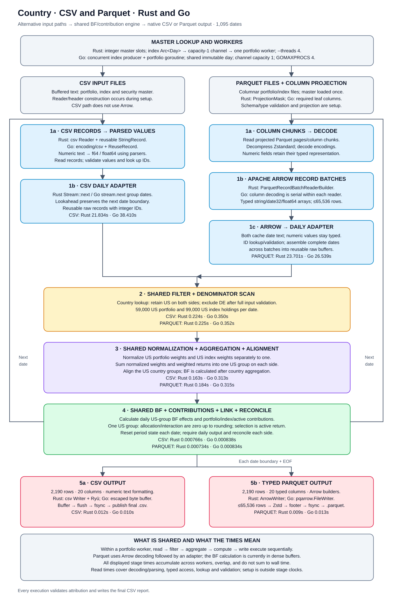

# Country attribution: US only

Country uses the latest rerun: three runs per engine/format. Its elapsed-time breakdown uses one complete run per column, selected by the middle whole-run time; supporting metrics use medians. Other scenarios retain their date-cache follow-up runs. The latest country runs alternate format and engine order and execute sequentially.

Keep US holdings in the portfolio and index. Scale each side’s US weights to 100%, then calculate daily Brinson–Fachler effects and return contributions.

**Scope:** 1,095 dates (2023-01-01 to 2025-12-30), 59,000 US portfolio holdings and 99,000 US index holdings per date. DE holdings are excluded.

**Output:** 2,190 rows per run—one US group × 1,095 dates × base/local returns. CSV input writes CSV; Parquet input writes Parquet. All reports include the same 20 columns.

## Total runtime

| Input → output | Rust seconds | Go seconds | Output rows |
|---|---:|---:|---:|
| CSV → CSV | 13.430 | 22.980 | 2,190 |
| PARQUET → PARQUET | 14.945 | 16.636 | 2,190 |

## Country Parquet: read-time split

| Part of reading | What is actually measured | Rust seconds | Go seconds |
|---|---|---:|---:|
| Fetch decoded Arrow batches | File reading + decompression + decoding + Arrow array creation; timed around each batch fetch. | 6.859 | 16.004 |
| Read decoded rows and prepare daily calculation data | Read typed Arrow values, reuse cached date text, look up security positions, validate rows, assemble each date and fill reusable calculation arrays. Calculated as total read time minus batch-fetch time. | 14.973 | 11.307 |
| Total read | Both parts above; excludes filtering, grouping, Brinson calculations and output writing. | 21.832 | 27.311 |

**Decompression is included, not measured separately from file reading and decoding. No decompression optimization was made.** The implemented optimization caches date strings instead of formatting a date for every row. Preparing calculation data still handles rows individually; it is more than copying an Arrow buffer.

These are separate profiling runs, not the normal runtime runs. For each engine, all three country runs cover all 1,095 dates; the table uses the run with the middle total read time and takes both parts from that same run. Times add the concurrent index and portfolio readers, so they can exceed whole-run runtime. Rust and Go were measured in separate sessions; Go diagnostics also enabled CPU/allocation profiling.

Both engines passed all six country Parquet profiling-output comparisons against their CSV and Parquet reference outputs. This checks decoded results; it does not isolate decompression performance.

[Rust profiling measurements](results/rust-date-cache/profile/runs.json) · [Go profiling measurements](results/go-date-cache/profile/runs.json)

Go: decoding, row handling, allocations and garbage collection

Country diagnostic runs only: three runs per format, separate from the normal timing runs above. These measure the whole process, including setup and output.

| Memory / garbage collection | CSV | Parquet with cached dates |
|---|---:|---:|
| Total allocated GiB | 11.577 | 80.389 |
| Allocated objects (millions) | 175.698 | 4.243 |
| Garbage collections | 467.000 | 1173.000 |
| Estimated garbage-collection CPU seconds | 1.273 | 6.969 |
| Pause seconds | 0.026 | 0.110 |

Values above are medians. Allocated GiB is the total allocated over the run, **not peak memory**. Garbage-collection CPU is a Go-runtime estimate that may overestimate CPU use and is not directly comparable with OS CPU time. It overlaps the stage measurements; do not add it to runtime.

| Work sampled on CPU | CSV CPU seconds | Parquet CPU seconds |
|---|---:|---:|
| File reads | 17.267 | 7.683 |
| Text parsing / Parquet decoding | 10.380 | 2.707 |
| Row handling and ID lookup | 2.850 | 4.460 |
| Allocate / resize memory | 0.543 | 0.733 |
| Garbage collection | 0.780 | 2.903 |
| Release unused heap memory | 0.037 | 1.800 |
| Go runtime / profiling support | 4.513 | 10.207 |

CPU rows are means from 10 ms samples, not elapsed stage times. Each sample is counted once; parsing/decoding and row handling exclude samples assigned to file reads, allocation or garbage collection. Runtime support includes scheduling, waits and profiling support. Remaining calculation, output and setup samples are in the full Go report.

CSV spends most sampled CPU on file reads and text parsing. Parquet allocates large Arrow and dictionary-decoding buffers. A separate single-run control with the date cache disabled creates about 175.2 million more objects than cached Parquet; the cache removes repeated date-string allocations.

[Full Go analysis](GO_DATE_READ_REPORT.md) · [Diagnostic measurements](results/go-date-cache/profile/runs.json) · [Diagnostic checks](results/go-date-cache/profile/checks.json)

## Elapsed time and processing steps

Each timing column below sums to whole-run elapsed time. Overlapping index work is not counted twice.

### CSV input → CSV output

| Step | Work done | Rust elapsed seconds | Go elapsed seconds |
|---|---|---:|---:|
| Read | Read and check portfolio CSV records. | 9.245057 | 15.927452 |
| Filter | Keep US portfolio holdings. | 0.103318 | 0.138032 |
| Prepare / group | Scale portfolio US weights to 100% and combine their weighted returns into one US group. | 0.070083 | 0.116835 |
| Calculate | Calculate the US group’s BF effects and contributions for each date. | 0.000766 | 0.000832 |
| Write | Save the CSV report to disk. | 0.011830 | 0.010097 |
| Setup, waiting, and remaining work | Everything outside the timed portfolio stages, including waiting for index data, setup and shutdown; calculated as whole run minus the five stages. | 3.998659 | 6.786590 |
| **Whole run** | **Sum of the six rows above.** | 13.429713 | 22.979838 |

Each column sums to whole-run elapsed time. All values in a column come from the same run: the middle whole-run time of three repetitions. The five timed stages follow the portfolio worker; index preparation runs concurrently and is not added again. The remaining-time row is a subtraction, not a separately measured index-reading or waiting timer. Other supporting metrics retain three-run medians.

[Latest country measurements](results/country-worker-stages/runs.csv) · [Output checks](results/country-worker-stages/checks.json)

Counts, throughput, and memory — CSV

Steps follow the timing table. Throughput rates use combined index and portfolio stage time; this denominator counts overlapping worker time.

| Step | Supporting metric | Rust | Go |
|---|---|---:|---:|
| Read | Million rows read per second | 8.024 | 4.561 |
| Read | CSV bytes parsed per second (MiB) | 551.294 | 313.387 |
| Read | Stored file size / read time (MiB/sec) | 551.441 | 313.471 |
| Filter | Rows checked | 175,200,000 | 175,200,000 |
| Filter | Rows kept | 173,010,000 | 173,010,000 |
| Prepare / group | Rows prepared per second | 1,064,181,171.822 | 553,287,476.298 |
| Prepare / group | Groups prepared across dates, counting portfolio and index separately | 2,190 | 2,190 |
| Calculate | Daily BF effect values calculated | 6,570 | 6,570 |
| Calculate | Daily BF effect values per second | 8,577,706.580 | 7,843,989.379 |
| Calculate | Final BF effect values / calculation time | 8,577,706.580 | 7,843,989.379 |
| Calculate | Report rows | 2,190 | 2,190 |
| Write | Report rows written per second | 181,655.408 | 216,898.063 |
| Write | Output written per second (MiB) | 56.153 | 66.580 |
| Write | Report rows written | 2,190 | 2,190 |
| Write | Output file size (MB) | 0.709851 | 0.704911 |
| Whole run | Runtime range across repeat runs | 13.393–15.862 | 22.903–23.526 |
| Whole run | Highest memory use (MiB) | 42.797 | 76.672 |
| Whole run | Total CPU time (seconds) | 22.394922 | 40.567501 |
| Whole run | Average CPU cores used | 1.672 | 1.761 |

MiB = 1,048,576 bytes; MB = 1,000,000 bytes. The stored-file rate uses file size, not measured disk traffic. Parquet has no parsed-text byte count. Both engines use three-run country medians.

### PARQUET input → PARQUET output

| Step | Work done | Rust elapsed seconds | Go elapsed seconds |
|---|---|---:|---:|
| Read | Read and decode portfolio Parquet batches. | 9.055367 | 10.362680 |
| Filter | Keep US portfolio holdings. | 0.102618 | 0.137314 |
| Prepare / group | Scale portfolio US weights to 100% and combine their weighted returns into one US group. | 0.061585 | 0.119112 |
| Calculate | Calculate the US group’s BF effects and contributions for each date. | 0.000734 | 0.000815 |
| Write | Save the PARQUET report to disk. | 0.010223 | 0.011689 |
| Setup, waiting, and remaining work | Everything outside the timed portfolio stages, including waiting for index data, setup and shutdown; calculated as whole run minus the five stages. | 5.714021 | 6.004804 |
| **Whole run** | **Sum of the six rows above.** | 14.944548 | 16.636414 |

Each column sums to whole-run elapsed time. All values in a column come from the same run: the middle whole-run time of three repetitions. The five timed stages follow the portfolio worker; index preparation runs concurrently and is not added again. The remaining-time row is a subtraction, not a separately measured index-reading or waiting timer. Other supporting metrics retain three-run medians.

[Latest country measurements](results/country-worker-stages/runs.csv) · [Output checks](results/country-worker-stages/checks.json)

Counts, throughput, and memory — PARQUET

Steps follow the timing table. Throughput rates use combined index and portfolio stage time; this denominator counts overlapping worker time.

| Step | Supporting metric | Rust | Go |
|---|---|---:|---:|
| Read | Million rows read per second | 7.392 | 6.602 |
| Read | CSV bytes parsed per second (MiB) | N/A (no parsed-byte counter) | N/A (no parsed-byte counter) |
| Read | Stored file size / read time (MiB/sec) | 213.841 | 190.975 |
| Filter | Rows checked | 175,200,000 | 175,200,000 |
| Filter | Rows kept | 173,010,000 | 173,010,000 |
| Prepare / group | Rows prepared per second | 938,202,462.215 | 549,213,398.071 |
| Prepare / group | Groups prepared across dates, counting portfolio and index separately | 2,190 | 2,190 |
| Calculate | Daily BF effect values calculated | 6,570 | 6,570 |
| Calculate | Daily BF effect values per second | 8,955,699.955 | 7,878,434.674 |
| Calculate | Final BF effect values / calculation time | 8,955,699.955 | 7,878,434.674 |
| Calculate | Report rows | 2,190 | 2,190 |
| Write | Report rows written per second | 242,054.318 | 175,071.316 |
| Write | Output written per second (MiB) | 21.873 | 16.164 |
| Write | Report rows written | 2,190 | 2,190 |
| Write | Output file size (MB) | 0.207507 | 0.212026 |
| Whole run | Runtime range across repeat runs | 13.181–15.069 | 16.475–16.750 |
| Whole run | Highest memory use (MiB) | 105.812 | 205.578 |
| Whole run | Total CPU time (seconds) | 21.528375 | 33.832283 |
| Whole run | Average CPU cores used | 1.446 | 2.034 |

MiB = 1,048,576 bytes; MB = 1,000,000 bytes. The stored-file rate uses file size, not measured disk traffic. Parquet has no parsed-text byte count. Both engines use three-run country medians.

View the country flow diagram

Calculation and worker details

US weights and weighted base/local returns are added into one US group separately for the portfolio and index on each date. There is no linking across dates in this scenario. With one normalized country group, allocation and interaction are zero apart from rounding; selection equals the difference between US portfolio and US index returns.

Daily portfolio and benchmark contributions equal the corresponding US weighted returns. Active contribution is their difference. The index producer runs concurrently with one portfolio worker; stages inside the portfolio worker run in sequence. Parquet uses Arrow for reading and writing, while the calculations use the shared daily buffers.

## Checks and measurement notes

**Latest checks:** Rust country has 15 output comparisons and 6 profiling comparisons; Go country has 15 output comparisons and 14 diagnostic/control comparisons. All passed; original baseline checks are retained. The new worker-timing country rerun adds 24 passed comparisons against the existing CSV/Parquet references. Every output value is compared; each engine checks BF and contribution totals.

The latest country rerun uses three runs per engine/format, alternating format and engine order. Runs execute sequentially with four configured threads and normal filesystem caching. CPU/allocation profiling and batch-fetch diagnostic timers are disabled for this rerun. The read-time split and Go allocation findings above remain from earlier separate diagnostic runs.

[Latest country rerun](results/country-worker-stages/runs.csv) · [Rerun checks](results/country-worker-stages/checks.json) · [Full comparison](CSV_PARQUET_REPORT.md) · [Latest Rust measurements](results/rust-date-cache/runs.csv) · [Latest Go measurements](results/go-date-cache/runs.csv) · [Original measurements](results/csv-parquet-native-output/runs.csv) · [Checks](results/csv-parquet-native-output/checks.json) · [Calculation definitions](docs/CONTRIBUTIONS.md)
