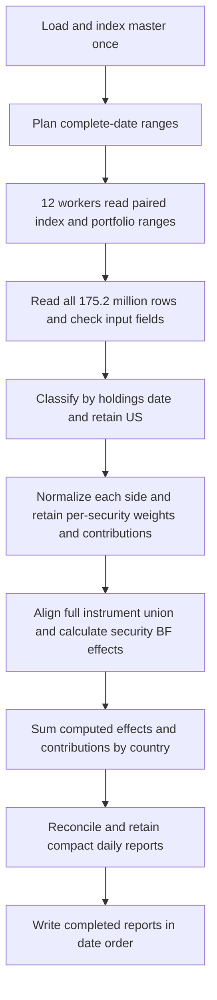

# Country attribution: security effects before country aggregation

**Current calculation and benchmarks, 2 November 2026.** Both Rust and Go calculate Brinson–Fachler effects per security, then sum effects, weights and contributions into daily US country reports.

The previous implementation grouped returns by country before calculating attribution. Its 2.750s undated Rust Parquet result measures that earlier calculation and is superseded here. Component values from those runs are not correctness baselines for the new calculation.

## Latest full-data runtimes

| Master | Input → output | Rust seconds | Go seconds | Repetitions per engine |
|---|---|---:|---:|---:|
| History | CSV → CSV | 14.524 | 19.873 | 1 |
| History | PARQUET → PARQUET | 6.122 | 10.101 | 1 |

Values are single complete release-build runs with the historical SMF. No thread override; 12 workers and 24 paired date-range tasks. macOS purge runs before each native invocation, outside measured runtime. These measurements do not independently verify eviction; file sizes do not establish physical disk traffic. Native elapsed time includes master loading, input planning, processing and report finalization. Process timing additionally includes startup, metrics serialization and exit.


## Input volume and actual calculation work

| Source | Holdings per date | Dates | Total rows |
|---|---:|---:|---:|
| Index | 100,000 | 1,095 | 109,500,000 |
| Portfolio PF | 60,000 | 1,095 | 65,700,000 |
| Total holdings read | 160,000 | 1,095 | 175,200,000 |
| US rows retained | 158,000 | 1,095 | 173,010,000 |

Dates span 1 January 2023 through 30 December 2025. Holdings are the original files linked into isolated benchmark inputs. Parquet holdings total 5,314,172,595 bytes (5.314 GB); the undated Parquet master adds 241,007 bytes. CSV contains the same holdings.

The historical master contains 5,760,000 records: 160,000 instruments × 36 monthly versions. The undated master has 160,000 rows and schema `InstrumentId,Currency,Country`. Every historical classification was checked to be constant per instrument before collapse. Historical Parquet is regenerated from CSV and verified field by field. Removing history would not preserve results for genuinely changing classifications.

The retained US index and portfolio have no shared IDs in this fixture. Their union contains 158,000 securities per date, or 173,010,000 security-date pairs. Each pair receives three effects for each of two return types: **1,038,060,000 effect values per portfolio run**. Output remains 2,190 country rows (1,095 dates × base/local), with 20 fields.

### Calculation scope

- Read all **175.2 million** holdings rows and check dates, known instrument IDs, duplicate holdings, finite returns, nonnegative weights and daily weights summing to one.
- US filtering retains **173.01 million** rows.
- Normalize portfolio and benchmark US weights separately, preserving security-level detail.
- Compute security-level attribution for **173.01 million security-date pairs**, producing **1.038 billion allocation, selection and interaction values** across base and local returns.
- Sum the computed security effects, weights and contributions by country and date.
- Write **2,190 daily country rows**: 1,095 dates × base/local returns, containing **6,570 aggregated attribution effect values**.

## Processing steps

[Open the SVG processing flow and missing-side worked example](docs/flows/country-parallel-end-to-end.svg).



1. Load the master once and share its immutable instrument/version index. Historical lookup selects the latest version effective on or before each holdings date; undated lookup uses the sole version.
2. CSV planning scans physical records for whole-date byte boundaries. Parquet planning inspects footer statistics and keeps all row groups for a date together. Each parallel task owns a matching date range across the index and every portfolio.
3. Read Entity, EffectiveDate, InstrumentId, Weight, BaseReturn and LocalReturn. Validate IDs, duplicate instruments, date order, entities, numeric values and original daily weights summing to one.
4. Resolve country on each holdings date, retain US on each side and sum its selected weights. Reject zero selected weight. Normalize weights and weighted return contributions separately for portfolio and benchmark, preserving instrument IDs.
5. Sum benchmark security contributions to obtain the applicable total benchmark return. Align the full security union, including portfolio-only and benchmark-only instruments with zero weight on the missing side. Compute effects independently for base and local returns.
6. Add each computed security effect to its country accumulator. Also sum normalized weights and contributions there. No country return is used as an attribution input. Country reporting is daily; effects are not linked across dates.
7. Check that effects sum to active return and contributions reconcile. Workers discard security buffers after each date; only compact computed country reports survive across dates. This avoids retaining all historical security detail.
8. Collect reports into date order, validate entity consistency and range exhaustion, write CSV or typed Zstd Parquet, and finalize partial reports only after successful processing.

## Security contributions

Compute contributions separately for base and local returns using each side’s normalized US weights:

```text
PortfolioContribution_i = Wp_i × rp_i
BenchmarkContribution_i = Wb_i × rb_i
ActiveContribution_i = PortfolioContribution_i − BenchmarkContribution_i
```

Sum security contributions by country and date. With the US weights normalized to one on each side, their country contributions equal the respective daily US returns. Contribution measures the amount added to return; attribution decomposes active return into allocation, selection and interaction.

## Security formulas and missing-side behavior

For each security i and return type, Wp/Wb are normalized security weights, rp/rb are security returns, and RB is the total US benchmark return:

```text
Allocation_i  = (Wp_i − Wb_i) × (rb_i − RB)
Selection_i   = Wb_i × (rp_i − rb_i)
Interaction_i = (Wp_i − Wb_i) × (rp_i − rb_i)
CountryEffect = sum(SecurityEffect_i for retained securities in country)
```

### A security missing from one side

For the attribution formulas, copy the available security return into the missing side while keeping the missing side’s weight at zero. Portfolio-only means `Wb = 0` and `rb = rp`; benchmark-only means `Wp = 0` and `rp = rb`. The implementation applies this convention to zero-weight holdings as well. If both weights are zero, both formula returns are zero and all effects are zero. The copied return is a model input, not an observed return for a holding on the missing side.

For example, security A appears only in the portfolio, with a normalized weight of 2% and a return of 5%. The total US benchmark return is 3%:

| Input | Portfolio | Benchmark |
|---|---:|---:|
| Normalized security weight | 2% | **0%** |
| Security return used in formulas | 5% | **5% copied from portfolio** |

```text
Allocation  = (0.02 − 0) × (0.05 − 0.03) = 0.0004 = 4 basis points
Selection   = 0 × (0.05 − 0.05) = 0
Interaction = (0.02 − 0) × (0.05 − 0.05) = 0
Portfolio contribution = 0.02 × 0.05 = 0.001 = 10 basis points
Benchmark contribution = 0 × 0.05 = 0
```

Copying the return creates no benchmark weight or contribution. Under this convention, the effect of an unmatched security goes into allocation. Individual security attribution need not equal its active contribution; effects reconcile to active return after summing the complete security union.

For the reverse example—a benchmark-only holding with Wb = 2%, rb = 5% and RB = 3%—use Wp = 0 and rp = 5%. Allocation is −4 basis points; selection and interaction are zero.

The current disjoint US fixture therefore has zero selection and interaction, with allocation carrying active return up to rounding. This follows the existing model convention. A separate hand-calculated fixture with shared IDs proves nonzero selection and interaction and distinguishes security-first calculation from country-first calculation.

## Phase timing and memory

All values below are from the recorded single runs. Worker-stage timers overlap and do not add to whole-run elapsed time. Parallel processing now includes security attribution, country accumulation and daily reconciliation. The legacy metric key `parallel_read_filter_aggregate_wall_seconds` covers that full interval; `ordered_compute_write_wall_seconds` now covers ordered report checks and writing.

| Master / engine / format | Master load s | Plan s | Parallel processing s | Ordered output s | Peak RSS MiB |
|---|---:|---:|---:|---:|---:|
| history / rust / csv | 0.622 | 8.371 | 5.524 | 0.007 | 695.875 |
| history / go / csv | 1.212 | 9.075 | 9.580 | 0.007 | 1152.734 |
| history / rust / parquet | 1.076 | 0.005 | 5.031 | 0.009 | 1056.922 |
| history / go / parquet | 1.404 | 0.011 | 8.673 | 0.012 | 2737.359 |

`groups` now counts present normalized security slots before attribution (173,010,000), rather than the old country aggregates. `effect_values` counts security effects, including all unmatched securities. `aggregate_seconds` measures normalization and security buffer preparation; `compute_seconds` includes security BF evaluation, country reduction and reconciliation. These counters are not directly comparable with the old country-first counters.

## Validation

- All 4 recorded runs process the documented rows and effect counts. Every output field matches across engines and formats with zero numeric difference.
- The independent Python oracle computes effects per security before country reduction across nine scenario/period cases; all pass in both engines.
- A hand-calculated regression checks overlapping and unmatched IDs, differently ordered holdings and an effective-dated US-to-DE transition, in both engines, both formats and streaming/parallel execution.
- 78 exact CSV and 156 exact Parquet serial/parallel comparisons pass, including multiple portfolios, limits, layout fallbacks and invalid inputs.
- CSV/Parquet/mixed-input parity across nine scenario/period cases passes, including >65k holdings per date. Rust unit tests and Go unit tests pass.
- The final Go build also passes native race-detector execution of the hand-calculated regression and 72 Parquet serial/parallel output comparisons, including invalid fixtures.

## Evidence and reproduction

- [All run metrics and process resources](results/country-cold-20261102-192052-rep3/runs.json)
- [Recorded measurements](results/country-cold-20261102-192052-rep3/runs.json)
- [Exact output comparisons](results/country-cold-20261102-192052-rep3/checks.json)
- [Environment, binary hashes and master verification](results/country-cold-20261102-192052-rep3/environment.json)

```sh
cargo build --release --locked --manifest-path rust/Cargo.toml
go -C go build -o ../benchmark-go-attribution ./cmd/attribution
.venv/bin/python python/benchmark_static_smf.py --output-dir results/new-security-country --runs 3
.venv/bin/python python/render_country_report.py
```

Choose a new results directory. The benchmark refreshes this report after all runs pass. Refreshing the renderer alone uses the recorded evidence without rerunning engines.

## Earlier measurements with a different calculation order

The preceding country-first experiment recorded median Rust/Go CSV times of 12.505s/15.320s without history and 15.934s/19.504s with history; Parquet times were 2.750s/4.529s without history and 6.435s/9.757s with history. Those runs reduced securities into country returns before calculating effects. They are retained as [historical evidence](results/country-static-smf-v2-2026-11-02/summary.json), not as performance or output parity claims for this corrected calculation.

<!-- security-country-results: results/country-cold-20261102-192052-rep3 -->
