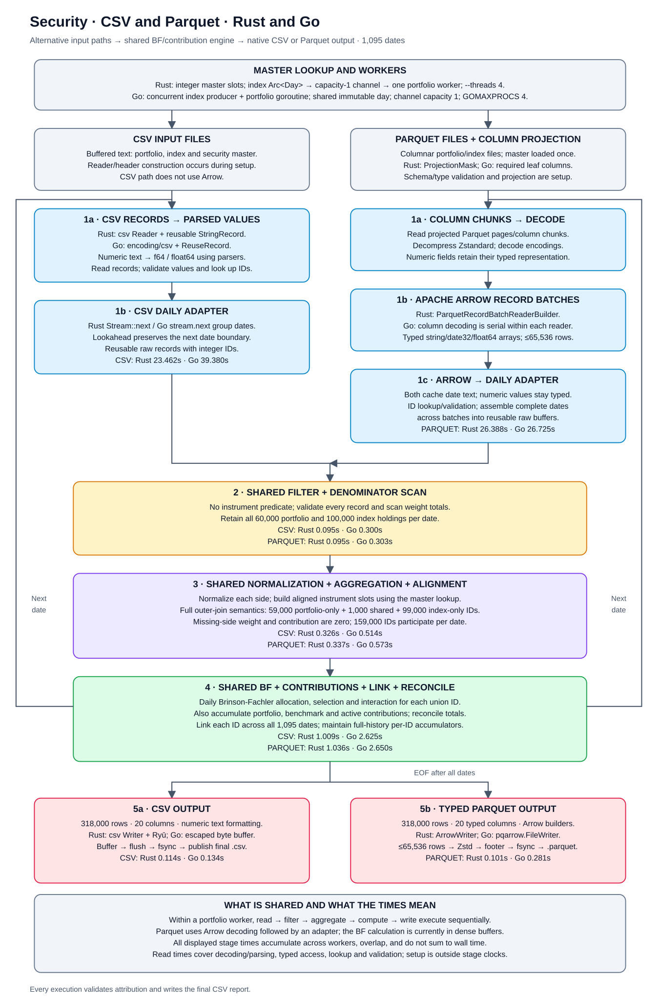
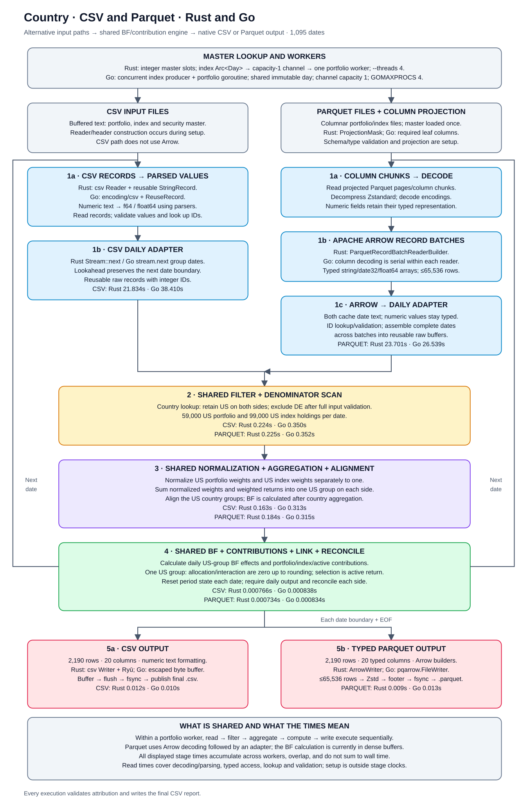
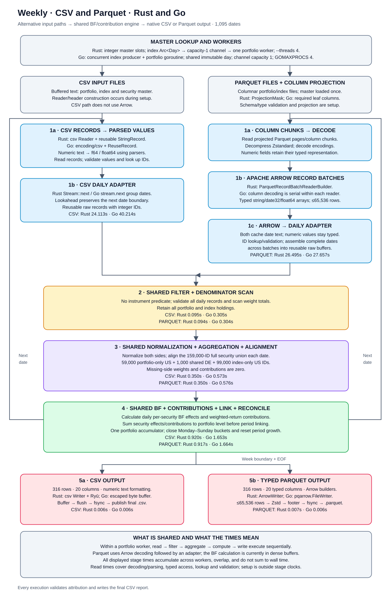
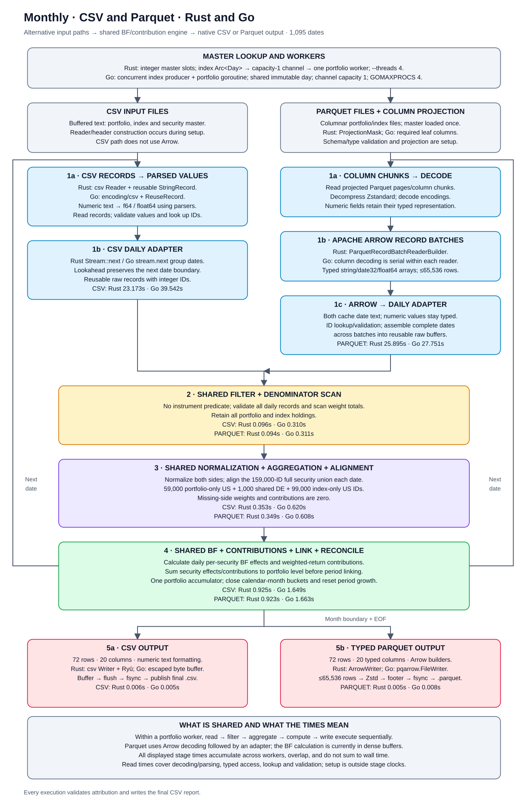

# CSV vs Parquet: Go and Rust

Both engines use their date-cache follow-up measurements: Country is the median of three CSV/Parquet pairs per engine; each other scenario uses one pair. Rust and Go were measured in separate sessions.
Updated with date caches in both Rust and Go.

Parquet/CSV total wall-time ratio across the five scenarios: Rust **1.15×**, Go **0.73×** (below 1 means Parquet was faster for the displayed results).

Country cells are three-run medians for both engines; other cells are single runs; 1,095 dates, one 60,000-security portfolio, a 100,000-security index, and 1,000 shared DE IDs. Four threads configured for both engines. BF effects and contribution columns included. CSV input writes CSV; Parquet input writes typed Zstandard Parquet.

## Total runtime (seconds)

| Scenario | Output rows | CSV Rust | CSV Go | Parquet Rust | Parquet Go |
|---|---:|---:|---:|---:|---:|
| Security | 318,000 | 14.22 | 23.91 | 16.77 | 17.47 |
| Country | 2,190 | 13.07 | 23.22 | 14.78 | 16.77 |
| Weekly | 316 | 14.45 | 24.16 | 16.74 | 17.42 |
| Monthly | 72 | 14.10 | 23.75 | 16.37 | 17.46 |
| Subset | 602 | 13.88 | 23.06 | 15.62 | 16.79 |

## Resources across all five scenarios

| Engine | CSV CPU s¹ | Parquet CPU s¹ | CSV max memory MiB² | Parquet max memory MiB² |
|---|---:|---:|---:|---:|
| Rust | 120.04 | 118.47 | 70.81 | 146.95 |
| Go | 215.30 | 180.15 | 163.36 | 261.39 |

¹ Sum of the displayed scenario CPU values; Country uses three-run medians for both engines. ² Highest memory use observed, including repeats.

Checks: the updated Rust and Go outputs each passed 35 comparisons against the original results and fresh CSV/Parquet outputs. Rust has 14 passed profiling checks; Go has 14 passed diagnostic/control checks. Each engine checks BF and contribution totals.

Subset: 400 IDs—200 portfolio-only US, 100 index-only US, 100 shared DE; 300 held IDs × 2 + 2 residual rows = 602. Country: US-filtered, separately normalized daily attribution.

Latest Rust Country pairs alternate CSV/Parquet order over three pairs; other Rust scenarios have one fresh pair. Go also uses three alternating country pairs and one fresh pair per other scenario. All used normal filesystem caching. Total runtime includes setup, reading, calculation and saving the finished output.

[Raw runs and stage metrics](results/csv-parquet-native-output/runs.csv) · [Validation](results/csv-parquet-native-output/checks.json) · [Environment](results/csv-parquet-native-output/environment.json)

Latest measurements: [Rust](results/rust-date-cache/runs.csv) · [Go](results/go-date-cache/runs.csv). Detailed diagnostics: [Go read report](GO_DATE_READ_REPORT.md).
## Country Parquet: read-time split

| Part of reading | What is actually measured | Rust seconds | Go seconds |
|---|---|---:|---:|
| Fetch decoded Arrow batches | File reading + decompression + decoding + Arrow array creation; timed around each batch fetch. | 6.859 | 16.004 |
| Read decoded rows and prepare daily calculation data | Read typed Arrow values, reuse cached date text, look up security positions, validate rows, assemble each date and fill reusable calculation arrays. Calculated as total read time minus batch-fetch time. | 14.973 | 11.307 |
| Total read | Both parts above; excludes filtering, grouping, Brinson calculations and output writing. | 21.832 | 27.311 |

**Decompression is included, not measured separately from file reading and decoding. No decompression optimization was made.** The implemented optimization caches date strings instead of formatting a date for every row. Preparing calculation data still handles rows individually; it is more than copying an Arrow buffer.

These are separate profiling runs, not the normal runtime runs. For each engine, all three country runs cover all 1,095 dates; the table uses the run with the middle total read time and takes both parts from that same run. Times add the concurrent index and portfolio readers, so they can exceed whole-run runtime. Rust and Go were measured in separate sessions; Go diagnostics also enabled CPU/allocation profiling.

Both engines passed all six country Parquet profiling-output comparisons against their CSV and Parquet reference outputs. This checks decoded results; it does not isolate decompression performance.

[Rust profiling measurements](results/rust-date-cache/profile/runs.json) · [Go profiling measurements](results/go-date-cache/profile/runs.json)

## Rust Parquet: where read time goes

These separate profiling runs split the read step. Times combine both readers, so they can exceed total runtime. Country uses the run with the middle read time out of three; other scenarios use one.

| Scenario | Read + decompress/decode seconds | Read decoded rows + prepare calculation data seconds | Total read seconds |
|---|---:|---:|---:|
| Security | 7.077 | 16.147 | 23.224 |
| Country | 6.859 | 14.973 | 21.832 |
| Weekly | 7.014 | 15.710 | 22.724 |
| Monthly | 7.064 | 15.414 | 22.478 |
| Subset | 7.008 | 14.641 | 21.649 |

The first part includes file I/O, decompression, decoding and Arrow batch creation. The second includes row handling, date caching, ID lookup, validation and building daily buffers. It is the remaining read time after subtracting batch time.

[Full date-cache comparison and profiling evidence](RUST_DATE_READ_REPORT.md)

## Go Parquet: where read time goes

These separate profiling runs split the read step. Times combine both readers, so they can exceed total runtime. Country uses the run with the middle read time out of three; other scenarios use one.

| Scenario | Read + decompress/decode seconds | Read decoded rows + prepare calculation data seconds | Total read seconds |
|---|---:|---:|---:|
| Country | 16.004 | 11.307 | 27.311 |

The first part includes file I/O, decompression, decoding and Arrow batch creation. The second includes row handling, date caching, ID lookup, validation and building daily buffers. It is the remaining read time after subtracting batch time.

[Full date-cache comparison and profiling evidence](GO_DATE_READ_REPORT.md)

Go: decoding, row handling, allocations and garbage collection

Country diagnostic runs only: three runs per format, separate from the normal timing runs above. These measure the whole process, including setup and output.

| Memory / garbage collection | CSV | Parquet with cached dates |
|---|---:|---:|
| Total allocated GiB | 11.577 | 80.389 |
| Allocated objects (millions) | 175.698 | 4.243 |
| Garbage collections | 467.000 | 1173.000 |
| Estimated garbage-collection CPU seconds | 1.273 | 6.969 |
| Pause seconds | 0.026 | 0.110 |

Values above are medians. Allocated GiB is the total allocated over the run, **not peak memory**. Garbage-collection CPU is a Go-runtime estimate that may overestimate CPU use and is not directly comparable with OS CPU time. It overlaps the stage measurements; do not add it to runtime.

| Work sampled on CPU | CSV CPU seconds | Parquet CPU seconds |
|---|---:|---:|
| File reads | 17.267 | 7.683 |
| Text parsing / Parquet decoding | 10.380 | 2.707 |
| Row handling and ID lookup | 2.850 | 4.460 |
| Allocate / resize memory | 0.543 | 0.733 |
| Garbage collection | 0.780 | 2.903 |
| Release unused heap memory | 0.037 | 1.800 |
| Go runtime / profiling support | 4.513 | 10.207 |

CPU rows are means from 10 ms samples, not elapsed stage times. Each sample is counted once; parsing/decoding and row handling exclude samples assigned to file reads, allocation or garbage collection. Runtime support includes scheduling, waits and profiling support. Remaining calculation, output and setup samples are in the full Go report.

CSV spends most sampled CPU on file reads and text parsing. Parquet allocates large Arrow and dictionary-decoding buffers. A separate single-run control with the date cache disabled creates about 175.2 million more objects than cached Parquet; the cache removes repeated date-string allocations.

[Full Go analysis](GO_DATE_READ_REPORT.md) · [Diagnostic measurements](results/go-date-cache/profile/runs.json) · [Diagnostic checks](results/go-date-cache/profile/checks.json)

How the CSV and Parquet runs work

| Layer | CSV | Parquet / Arrow |
|---|---|---|
| Storage / decode | Buffered text records; parse numeric strings | Project Parquet columns; decompress/decode into typed Arrow RecordBatches |
| Daily adapter | Parsed values → reusable raw buffers | Typed Arrow access → reusable raw buffers; date fragments assembled across batches |
| Calculation | Dense ID/country slots; existing BF/contribution engine | Same dense engine after Arrow decoding |
| Filtering | After full record validation | After full record validation; no instrument predicate pushdown |
| Output | Text CSV formatting and buffering | Typed Arrow output batches → Zstandard Parquet row groups and footer |

**These runs measure Phase 2: native Parquet-to-Arrow readers feeding the existing calculation buffers. They do not measure an Arrow-native/vectorized BF engine.** Each scenario diagram shows the CSV and Arrow/Parquet paths converging at the shared calculation buffers. Output paths split again: CSV formatting for CSV inputs; typed Arrow batches, Parquet encoding/compression and footer finalization for Parquet inputs.

### Concurrency scope

The index producer and portfolio worker execute concurrently. With this merged single-portfolio fixture, there is one portfolio worker; a capacity-1 channel provides bounded index prefetch. Within that worker, portfolio reading, filtering, aggregation, BF/contribution calculation and output writing execute sequentially. There are no separate application-level stage workers or writer queue.

Go `pqarrow` uses `Parallel=false` only for decoding columns within each individual reader. It does not disable the concurrent index producer and portfolio goroutine. `GOMAXPROCS=4` permits four logical CPUs but does not create four portfolio workers or parallelize the security loop. Enabling per-column decoding would be a separate configuration experiment requiring new measurements.

## Elapsed time and processing steps

Each scenario has the same layout: a timing table, its supporting numbers, then the next input format. Read down to follow the steps; compare Rust and Go across the row.

All visible timing columns use elapsed clock seconds. Only whole-run elapsed time was recorded; stage rows describe the work without showing accumulated worker times.

Both engines use their date-cache follow-up measurements: Country is the median of three CSV/Parquet pairs per engine; each other scenario uses one pair. Rust and Go were measured in separate sessions.

### Security

#### CSV input → CSV output

| Step | Work done | Rust elapsed seconds | Go elapsed seconds |
|---|---|---:|---:|
| Read | Read and check CSV records. | — | — |
| Filter | Keep all holdings; total the weights on each side. | — | — |
| Prepare / group | Scale each side’s weights to 100%; line up matching security IDs. | — | — |
| Calculate | Calculate BF effects and contributions for every security over the full period. | — | — |
| Write | Save the CSV report to disk. | — | — |
| **Whole run** | Elapsed time from start to finish. | 14.222 | 23.915 |

— = elapsed stage time was not recorded. Existing stage measurements add worker times and are available in the expandable details; they cannot be converted into elapsed stage times.

Worker times, counts, throughput, and memory — Security, CSV

Steps appear in the same order as the timing table. Rates use the time spent in that step.

| Step | Supporting metric | Rust | Go |
|---|---|---:|---:|
| Read | Million rows read per second | 7.467 | 4.449 |
| Read | CSV bytes parsed per second (MiB) | 513.048 | 305.665 |
| Read | Stored file size / read time (MiB/sec) | 513.184 | 305.747 |
| Filter | Rows checked | 175,200,000 | 175,200,000 |
| Filter | Rows kept | 175,200,000 | 175,200,000 |
| Prepare / group | Rows prepared per second | 537,188,744.310 | 340,956,545.649 |
| Prepare / group | Groups prepared across dates, counting portfolio and index separately | 175,200,000 | 175,200,000 |
| Calculate | Daily BF effect values calculated | 1,044,630,000 | 1,044,630,000 |
| Calculate | Daily BF effect values per second | 1,035,704,459.502 | 397,879,816.254 |
| Calculate | Final BF effect values / calculation time | 945,848.821 | 363,360.563 |
| Calculate | Report rows | 318,000 | 318,000 |
| Write | Report rows written per second | 2,799,156.310 | 2,380,015.343 |
| Write | Output written per second (MiB) | 699.350 | 579.603 |
| Write | Report rows written | 318,000 | 318,000 |
| Write | Output file size (MB) | 83.309447 | 81.204076 |
| Whole run | Runtime range across repeat runs | N/A (one run) | N/A (one run) |
| Whole run | Highest memory use (MiB) | 70.812 | 163.359 |
| Whole run | Total CPU time (seconds) | 24.898769 | 44.279602 |
| Whole run | Average CPU cores used | 1.751 | 1.852 |

MiB = 1,048,576 bytes; MB = 1,000,000 bytes. The stored-file rate uses file size, not measured disk traffic. Parquet has no parsed-text byte count. BF value counts exclude contribution columns. Rust Country reports medians and an observed runtime range from three runs; other cells use one run. Memory shows the highest observed peak.

#### PARQUET input → PARQUET output

| Step | Work done | Rust elapsed seconds | Go elapsed seconds |
|---|---|---:|---:|
| Read | Read and decode Parquet batches. | — | — |
| Filter | Keep all holdings; total the weights on each side. | — | — |
| Prepare / group | Scale each side’s weights to 100%; line up matching security IDs. | — | — |
| Calculate | Calculate BF effects and contributions for every security over the full period. | — | — |
| Write | Save the PARQUET report to disk. | — | — |
| **Whole run** | Elapsed time from start to finish. | 16.773 | 17.468 |

— = elapsed stage time was not recorded. Existing stage measurements add worker times and are available in the expandable details; they cannot be converted into elapsed stage times.

Worker times, counts, throughput, and memory — Security, PARQUET

Steps appear in the same order as the timing table. Rates use the time spent in that step.

| Step | Supporting metric | Rust | Go |
|---|---|---:|---:|
| Read | Million rows read per second | 6.639 | 6.556 |
| Read | CSV bytes parsed per second (MiB) | N/A (no parsed-byte counter) | N/A (no parsed-byte counter) |
| Read | Stored file size / read time (MiB/sec) | 192.065 | 189.643 |
| Filter | Rows checked | 175,200,000 | 175,200,000 |
| Filter | Rows kept | 175,200,000 | 175,200,000 |
| Prepare / group | Rows prepared per second | 520,539,816.309 | 305,938,148.935 |
| Prepare / group | Groups prepared across dates, counting portfolio and index separately | 175,200,000 | 175,200,000 |
| Calculate | Daily BF effect values calculated | 1,044,630,000 | 1,044,630,000 |
| Calculate | Daily BF effect values per second | 1,008,749,772.288 | 394,202,305.563 |
| Calculate | Final BF effect values / calculation time | 921,232.669 | 360,002.106 |
| Calculate | Report rows | 318,000 | 318,000 |
| Write | Report rows written per second | 3,161,336.701 | 1,130,814.764 |
| Write | Output written per second (MiB) | 138.363 | 51.666 |
| Write | Report rows written | 318,000 | 318,000 |
| Write | Output file size (MB) | 14.594064 | 15.235043 |
| Whole run | Runtime range across repeat runs | N/A (one run) | N/A (one run) |
| Whole run | Highest memory use (MiB) | 146.953 | 261.391 |
| Whole run | Total CPU time (seconds) | 24.825229 | 36.671846 |
| Whole run | Average CPU cores used | 1.480 | 2.099 |

MiB = 1,048,576 bytes; MB = 1,000,000 bytes. The stored-file rate uses file size, not measured disk traffic. Parquet has no parsed-text byte count. BF value counts exclude contribution columns. Rust Country reports medians and an observed runtime range from three runs; other cells use one run. Memory shows the highest observed peak.

View the security flow diagram

### Country

#### CSV input → CSV output

| Step | Work done | Rust elapsed seconds | Go elapsed seconds |
|---|---|---:|---:|
| Read | Read and check CSV records. | — | — |
| Filter | Keep US holdings in the portfolio and index. | — | — |
| Prepare / group | Scale US weights to 100% on each side; add weighted returns into one US group. | — | — |
| Calculate | Calculate the US group’s BF effects and contributions for each date. | — | — |
| Write | Save the CSV report to disk. | — | — |
| **Whole run** | Elapsed time from start to finish. | 13.067 | 23.218 |

— = elapsed stage time was not recorded. Existing stage measurements add worker times and are available in the expandable details; they cannot be converted into elapsed stage times.

Worker times, counts, throughput, and memory — Country, CSV

Steps appear in the same order as the timing table. Rates use the time spent in that step.

| Step | Supporting metric | Rust | Go |
|---|---|---:|---:|
| Read | Million rows read per second | 8.059 | 4.513 |
| Read | CSV bytes parsed per second (MiB) | 553.706 | 310.065 |
| Read | Stored file size / read time (MiB/sec) | 553.854 | 310.148 |
| Filter | Rows checked | 175,200,000 | 175,200,000 |
| Filter | Rows kept | 173,010,000 | 173,010,000 |
| Prepare / group | Rows prepared per second | 1,026,188,197.043 | 559,628,419.409 |
| Prepare / group | Groups prepared across dates, counting portfolio and index separately | 2,190 | 2,190 |
| Calculate | Daily BF effect values calculated | 6,570 | 6,570 |
| Calculate | Daily BF effect values per second | 7,049,325.969 | 8,023,741.482 |
| Calculate | Final BF effect values / calculation time | 7,049,325.969 | 8,023,741.482 |
| Calculate | Report rows | 2,190 | 2,190 |
| Write | Report rows written per second | 195,566.306 | 242,016.628 |
| Write | Output written per second (MiB) | 60.453 | 74.291 |
| Write | Report rows written | 2,190 | 2,190 |
| Write | Output file size (MB) | 0.709851 | 0.704911 |
| Whole run | Runtime range across repeat runs | 12.982–13.283 | 22.114–23.246 |
| Whole run | Highest memory use (MiB) | 40.250 | 76.344 |
| Whole run | Total CPU time (seconds) | 22.089002 | 40.954650 |
| Whole run | Average CPU cores used | 1.677 | 1.770 |

MiB = 1,048,576 bytes; MB = 1,000,000 bytes. The stored-file rate uses file size, not measured disk traffic. Parquet has no parsed-text byte count. BF value counts exclude contribution columns. Rust Country reports medians and an observed runtime range from three runs; other cells use one run. Memory shows the highest observed peak.

#### PARQUET input → PARQUET output

| Step | Work done | Rust elapsed seconds | Go elapsed seconds |
|---|---|---:|---:|
| Read | Read and decode Parquet batches. | — | — |
| Filter | Keep US holdings in the portfolio and index. | — | — |
| Prepare / group | Scale US weights to 100% on each side; add weighted returns into one US group. | — | — |
| Calculate | Calculate the US group’s BF effects and contributions for each date. | — | — |
| Write | Save the PARQUET report to disk. | — | — |
| **Whole run** | Elapsed time from start to finish. | 14.776 | 16.772 |

— = elapsed stage time was not recorded. Existing stage measurements add worker times and are available in the expandable details; they cannot be converted into elapsed stage times.

Worker times, counts, throughput, and memory — Country, PARQUET

Steps appear in the same order as the timing table. Rates use the time spent in that step.

| Step | Supporting metric | Rust | Go |
|---|---|---:|---:|
| Read | Million rows read per second | 7.461 | 6.507 |
| Read | CSV bytes parsed per second (MiB) | N/A (no parsed-byte counter) | N/A (no parsed-byte counter) |
| Read | Stored file size / read time (MiB/sec) | 215.844 | 188.235 |
| Filter | Rows checked | 175,200,000 | 175,200,000 |
| Filter | Rows kept | 173,010,000 | 173,010,000 |
| Prepare / group | Rows prepared per second | 1,073,595,961.924 | 552,975,327.200 |
| Prepare / group | Groups prepared across dates, counting portfolio and index separately | 2,190 | 2,190 |
| Calculate | Daily BF effect values calculated | 6,570 | 6,570 |
| Calculate | Daily BF effect values per second | 8,170,656.028 | 8,093,186.202 |
| Calculate | Final BF effect values / calculation time | 8,170,656.028 | 8,093,186.202 |
| Calculate | Report rows | 2,190 | 2,190 |
| Write | Report rows written per second | 293,929.589 | 191,744.867 |
| Write | Output written per second (MiB) | 26.560 | 17.704 |
| Write | Report rows written | 2,190 | 2,190 |
| Write | Output file size (MB) | 0.207507 | 0.212026 |
| Whole run | Runtime range across repeat runs | 12.868–15.090 | 16.637–17.046 |
| Whole run | Highest memory use (MiB) | 110.000 | 206.281 |
| Whole run | Total CPU time (seconds) | 21.285223 | 34.304759 |
| Whole run | Average CPU cores used | 1.447 | 2.043 |

MiB = 1,048,576 bytes; MB = 1,000,000 bytes. The stored-file rate uses file size, not measured disk traffic. Parquet has no parsed-text byte count. BF value counts exclude contribution columns. Rust Country reports medians and an observed runtime range from three runs; other cells use one run. Memory shows the highest observed peak.

View the country flow diagram

### Weekly

#### CSV input → CSV output

| Step | Work done | Rust elapsed seconds | Go elapsed seconds |
|---|---|---:|---:|
| Read | Read and check CSV records. | — | — |
| Filter | Keep all holdings; total the weights on each side. | — | — |
| Prepare / group | Prepare weights and matching security IDs for each day. | — | — |
| Calculate | Add security results to portfolio totals, then combine them by week. | — | — |
| Write | Save the CSV report to disk. | — | — |
| **Whole run** | Elapsed time from start to finish. | 14.446 | 24.163 |

— = elapsed stage time was not recorded. Existing stage measurements add worker times and are available in the expandable details; they cannot be converted into elapsed stage times.

Worker times, counts, throughput, and memory — Weekly, CSV

Steps appear in the same order as the timing table. Rates use the time spent in that step.

| Step | Supporting metric | Rust | Go |
|---|---|---:|---:|
| Read | Million rows read per second | 7.266 | 4.357 |
| Read | CSV bytes parsed per second (MiB) | 499.192 | 299.325 |
| Read | Stored file size / read time (MiB/sec) | 499.325 | 299.405 |
| Filter | Rows checked | 175,200,000 | 175,200,000 |
| Filter | Rows kept | 175,200,000 | 175,200,000 |
| Prepare / group | Rows prepared per second | 501,169,158.708 | 306,017,267.307 |
| Prepare / group | Groups prepared across dates, counting portfolio and index separately | 175,200,000 | 175,200,000 |
| Calculate | Daily BF effect values calculated | 1,044,630,000 | 1,044,630,000 |
| Calculate | Daily BF effect values per second | 1,135,468,646.491 | 632,094,889.678 |
| Calculate | Final BF effect values / calculation time | 1,030.436 | 573.625 |
| Calculate | Report rows | 316 | 316 |
| Write | Report rows written per second | 53,987.793 | 49,377.785 |
| Write | Output written per second (MiB) | 15.102 | 13.548 |
| Write | Report rows written | 316 | 316 |
| Write | Output file size (MB) | 0.092687 | 0.090911 |
| Whole run | Runtime range across repeat runs | N/A (one run) | N/A (one run) |
| Whole run | Highest memory use (MiB) | 50.453 | 98.109 |
| Whole run | Total CPU time (seconds) | 25.424049 | 45.031998 |
| Whole run | Average CPU cores used | 1.760 | 1.864 |

MiB = 1,048,576 bytes; MB = 1,000,000 bytes. The stored-file rate uses file size, not measured disk traffic. Parquet has no parsed-text byte count. BF value counts exclude contribution columns. Rust Country reports medians and an observed runtime range from three runs; other cells use one run. Memory shows the highest observed peak.

#### PARQUET input → PARQUET output

| Step | Work done | Rust elapsed seconds | Go elapsed seconds |
|---|---|---:|---:|
| Read | Read and decode Parquet batches. | — | — |
| Filter | Keep all holdings; total the weights on each side. | — | — |
| Prepare / group | Prepare weights and matching security IDs for each day. | — | — |
| Calculate | Add security results to portfolio totals, then combine them by week. | — | — |
| Write | Save the PARQUET report to disk. | — | — |
| **Whole run** | Elapsed time from start to finish. | 16.744 | 17.420 |

— = elapsed stage time was not recorded. Existing stage measurements add worker times and are available in the expandable details; they cannot be converted into elapsed stage times.

Worker times, counts, throughput, and memory — Weekly, PARQUET

Steps appear in the same order as the timing table. Rates use the time spent in that step.

| Step | Supporting metric | Rust | Go |
|---|---|---:|---:|
| Read | Million rows read per second | 6.613 | 6.335 |
| Read | CSV bytes parsed per second (MiB) | N/A (no parsed-byte counter) | N/A (no parsed-byte counter) |
| Read | Stored file size / read time (MiB/sec) | 191.290 | 183.255 |
| Filter | Rows checked | 175,200,000 | 175,200,000 |
| Filter | Rows kept | 175,200,000 | 175,200,000 |
| Prepare / group | Rows prepared per second | 500,822,762.898 | 304,107,812.302 |
| Prepare / group | Groups prepared across dates, counting portfolio and index separately | 175,200,000 | 175,200,000 |
| Calculate | Daily BF effect values calculated | 1,044,630,000 | 1,044,630,000 |
| Calculate | Daily BF effect values per second | 1,139,463,684.899 | 627,686,733.846 |
| Calculate | Final BF effect values / calculation time | 1,034.061 | 569.625 |
| Calculate | Report rows | 316 | 316 |
| Write | Report rows written per second | 46,470.568 | 50,299.441 |
| Write | Output written per second (MiB) | 4.962 | 5.413 |
| Write | Report rows written | 316 | 316 |
| Write | Output file size (MB) | 0.035379 | 0.035660 |
| Whole run | Runtime range across repeat runs | N/A (one run) | N/A (one run) |
| Whole run | Highest memory use (MiB) | 126.500 | 223.547 |
| Whole run | Total CPU time (seconds) | 25.186351 | 37.510574 |
| Whole run | Average CPU cores used | 1.504 | 2.153 |

MiB = 1,048,576 bytes; MB = 1,000,000 bytes. The stored-file rate uses file size, not measured disk traffic. Parquet has no parsed-text byte count. BF value counts exclude contribution columns. Rust Country reports medians and an observed runtime range from three runs; other cells use one run. Memory shows the highest observed peak.

View the weekly flow diagram

### Monthly

#### CSV input → CSV output

| Step | Work done | Rust elapsed seconds | Go elapsed seconds |
|---|---|---:|---:|
| Read | Read and check CSV records. | — | — |
| Filter | Keep all holdings; total the weights on each side. | — | — |
| Prepare / group | Prepare weights and matching security IDs for each day. | — | — |
| Calculate | Add security results to portfolio totals, then combine them by month. | — | — |
| Write | Save the CSV report to disk. | — | — |
| **Whole run** | Elapsed time from start to finish. | 14.096 | 23.751 |

— = elapsed stage time was not recorded. Existing stage measurements add worker times and are available in the expandable details; they cannot be converted into elapsed stage times.

Worker times, counts, throughput, and memory — Monthly, CSV

Steps appear in the same order as the timing table. Rates use the time spent in that step.

| Step | Supporting metric | Rust | Go |
|---|---|---:|---:|
| Read | Million rows read per second | 7.560 | 4.431 |
| Read | CSV bytes parsed per second (MiB) | 519.437 | 304.411 |
| Read | Stored file size / read time (MiB/sec) | 519.576 | 304.492 |
| Filter | Rows checked | 175,200,000 | 175,200,000 |
| Filter | Rows kept | 175,200,000 | 175,200,000 |
| Prepare / group | Rows prepared per second | 496,642,168.847 | 282,691,820.103 |
| Prepare / group | Groups prepared across dates, counting portfolio and index separately | 175,200,000 | 175,200,000 |
| Calculate | Daily BF effect values calculated | 1,044,630,000 | 1,044,630,000 |
| Calculate | Daily BF effect values per second | 1,129,402,962.660 | 633,611,287.375 |
| Calculate | Final BF effect values / calculation time | 233.529 | 131.013 |
| Calculate | Report rows | 72 | 72 |
| Write | Report rows written per second | 11,765.592 | 13,264.855 |
| Write | Output written per second (MiB) | 3.318 | 3.671 |
| Write | Report rows written | 72 | 72 |
| Write | Output file size (MB) | 0.021288 | 0.020895 |
| Whole run | Runtime range across repeat runs | N/A (one run) | N/A (one run) |
| Whole run | Highest memory use (MiB) | 48.203 | 102.938 |
| Whole run | Total CPU time (seconds) | 24.406038 | 44.377285 |
| Whole run | Average CPU cores used | 1.731 | 1.868 |

MiB = 1,048,576 bytes; MB = 1,000,000 bytes. The stored-file rate uses file size, not measured disk traffic. Parquet has no parsed-text byte count. BF value counts exclude contribution columns. Rust Country reports medians and an observed runtime range from three runs; other cells use one run. Memory shows the highest observed peak.

#### PARQUET input → PARQUET output

| Step | Work done | Rust elapsed seconds | Go elapsed seconds |
|---|---|---:|---:|
| Read | Read and decode Parquet batches. | — | — |
| Filter | Keep all holdings; total the weights on each side. | — | — |
| Prepare / group | Prepare weights and matching security IDs for each day. | — | — |
| Calculate | Add security results to portfolio totals, then combine them by month. | — | — |
| Write | Save the PARQUET report to disk. | — | — |
| **Whole run** | Elapsed time from start to finish. | 16.366 | 17.464 |

— = elapsed stage time was not recorded. Existing stage measurements add worker times and are available in the expandable details; they cannot be converted into elapsed stage times.

Worker times, counts, throughput, and memory — Monthly, PARQUET

Steps appear in the same order as the timing table. Rates use the time spent in that step.

| Step | Supporting metric | Rust | Go |
|---|---|---:|---:|
| Read | Million rows read per second | 6.766 | 6.313 |
| Read | CSV bytes parsed per second (MiB) | N/A (no parsed-byte counter) | N/A (no parsed-byte counter) |
| Read | Stored file size / read time (MiB/sec) | 195.724 | 182.634 |
| Filter | Rows checked | 175,200,000 | 175,200,000 |
| Filter | Rows kept | 175,200,000 | 175,200,000 |
| Prepare / group | Rows prepared per second | 501,889,950.831 | 288,340,258.094 |
| Prepare / group | Groups prepared across dates, counting portfolio and index separately | 175,200,000 | 175,200,000 |
| Calculate | Daily BF effect values calculated | 1,044,630,000 | 1,044,630,000 |
| Calculate | Daily BF effect values per second | 1,131,359,257.367 | 628,063,529.980 |
| Calculate | Final BF effect values / calculation time | 233.933 | 129.866 |
| Calculate | Report rows | 72 | 72 |
| Write | Report rows written per second | 13,494.409 | 8,615.401 |
| Write | Output written per second (MiB) | 2.301 | 1.463 |
| Write | Report rows written | 72 | 72 |
| Write | Output file size (MB) | 0.012874 | 0.012819 |
| Whole run | Runtime range across repeat runs | N/A (one run) | N/A (one run) |
| Whole run | Highest memory use (MiB) | 126.656 | 223.703 |
| Whole run | Total CPU time (seconds) | 24.672630 | 37.537981 |
| Whole run | Average CPU cores used | 1.508 | 2.149 |

MiB = 1,048,576 bytes; MB = 1,000,000 bytes. The stored-file rate uses file size, not measured disk traffic. Parquet has no parsed-text byte count. BF value counts exclude contribution columns. Rust Country reports medians and an observed runtime range from three runs; other cells use one run. Memory shows the highest observed peak.

View the monthly flow diagram

### Subset

#### CSV input → CSV output

| Step | Work done | Rust elapsed seconds | Go elapsed seconds |
|---|---|---:|---:|
| Read | Read and check CSV records. | — | — |
| Filter | Keep the 400 selected IDs on both sides. | — | — |
| Prepare / group | Scale selected weights to 100% on each side; line up selected IDs. | — | — |
| Calculate | Calculate selected-security results; combine index-only results into one summary. | — | — |
| Write | Save the CSV report to disk. | — | — |
| **Whole run** | Elapsed time from start to finish. | 13.883 | 23.058 |

— = elapsed stage time was not recorded. Existing stage measurements add worker times and are available in the expandable details; they cannot be converted into elapsed stage times.

Worker times, counts, throughput, and memory — Subset, CSV

Steps appear in the same order as the timing table. Rates use the time spent in that step.

| Step | Supporting metric | Rust | Go |
|---|---|---:|---:|
| Read | Million rows read per second | 7.545 | 4.497 |
| Read | CSV bytes parsed per second (MiB) | 518.381 | 308.972 |
| Read | Stored file size / read time (MiB/sec) | 518.519 | 309.054 |
| Filter | Rows checked | 175,200,000 | 175,200,000 |
| Filter | Rows kept | 547,500 | 547,500 |
| Prepare / group | Rows prepared per second | 140,441,115.926 | 153,096,491.895 |
| Prepare / group | Groups prepared across dates, counting portfolio and index separately | 547,500 | 547,500 |
| Calculate | Daily BF effect values calculated | 2,628,000 | 2,628,000 |
| Calculate | Daily BF effect values per second | 888,726,263.856 | 341,044,645.184 |
| Calculate | Final BF effect values / calculation time | 610,745.674 | 234,370.863 |
| Calculate | Report rows | 602 | 602 |
| Write | Report rows written per second | 88,109.518 | 169,973.575 |
| Write | Output written per second (MiB) | 23.342 | 44.126 |
| Write | Report rows written | 602 | 602 |
| Write | Output file size (MB) | 0.167226 | 0.163874 |
| Whole run | Runtime range across repeat runs | N/A (one run) | N/A (one run) |
| Whole run | Highest memory use (MiB) | 40.359 | 76.344 |
| Whole run | Total CPU time (seconds) | 23.218193 | 40.652325 |
| Whole run | Average CPU cores used | 1.672 | 1.763 |

MiB = 1,048,576 bytes; MB = 1,000,000 bytes. The stored-file rate uses file size, not measured disk traffic. Parquet has no parsed-text byte count. BF value counts exclude contribution columns. Rust Country reports medians and an observed runtime range from three runs; other cells use one run. Memory shows the highest observed peak.

#### PARQUET input → PARQUET output

| Step | Work done | Rust elapsed seconds | Go elapsed seconds |
|---|---|---:|---:|
| Read | Read and decode Parquet batches. | — | — |
| Filter | Keep the 400 selected IDs on both sides. | — | — |
| Prepare / group | Scale selected weights to 100% on each side; line up selected IDs. | — | — |
| Calculate | Calculate selected-security results; combine index-only results into one summary. | — | — |
| Write | Save the PARQUET report to disk. | — | — |
| **Whole run** | Elapsed time from start to finish. | 15.618 | 16.787 |

— = elapsed stage time was not recorded. Existing stage measurements add worker times and are available in the expandable details; they cannot be converted into elapsed stage times.

Worker times, counts, throughput, and memory — Subset, PARQUET

Steps appear in the same order as the timing table. Rates use the time spent in that step.

| Step | Supporting metric | Rust | Go |
|---|---|---:|---:|
| Read | Million rows read per second | 6.982 | 6.420 |
| Read | CSV bytes parsed per second (MiB) | N/A (no parsed-byte counter) | N/A (no parsed-byte counter) |
| Read | Stored file size / read time (MiB/sec) | 201.990 | 185.719 |
| Filter | Rows checked | 175,200,000 | 175,200,000 |
| Filter | Rows kept | 547,500 | 547,500 |
| Prepare / group | Rows prepared per second | 192,415,964.304 | 112,471,612.473 |
| Prepare / group | Groups prepared across dates, counting portfolio and index separately | 547,500 | 547,500 |
| Calculate | Daily BF effect values calculated | 2,628,000 | 2,628,000 |
| Calculate | Daily BF effect values per second | 864,373,314.546 | 335,855,401.214 |
| Calculate | Final BF effect values / calculation time | 594,009.972 | 230,804.739 |
| Calculate | Report rows | 602 | 602 |
| Write | Report rows written per second | 94,059.399 | 101,032.020 |
| Write | Output written per second (MiB) | 5.706 | 6.239 |
| Write | Report rows written | 602 | 602 |
| Write | Output file size (MB) | 0.038292 | 0.038980 |
| Whole run | Runtime range across repeat runs | N/A (one run) | N/A (one run) |
| Whole run | Highest memory use (MiB) | 112.031 | 202.453 |
| Whole run | Total CPU time (seconds) | 22.498215 | 34.127748 |
| Whole run | Average CPU cores used | 1.441 | 2.033 |

MiB = 1,048,576 bytes; MB = 1,000,000 bytes. The stored-file rate uses file size, not measured disk traffic. Parquet has no parsed-text byte count. BF value counts exclude contribution columns. Rust Country reports medians and an observed runtime range from three runs; other cells use one run. Memory shows the highest observed peak.

View the subset flow diagram

